# 🎲 APP RPG

Aplicativo Android desenvolvido com o objetivo de auxiliar e complementar sessões de **RPG de mesa**, reunindo diferentes recursos relacionados à experiência de jogo em um único aplicativo.

> **Projeto em desenvolvimento**
>
> Este projeto está sendo desenvolvido de forma contínua ao longo do curso de **Ciência da Computação**, acompanhando a evolução dos conhecimentos adquiridos durante a disciplina Desenvolvimento Mobile. Novas funcionalidades, melhorias de interface, correções e ajustes serão adicionados conforme o desenvolvimento do projeto avançar.

📄 Processo de desenvolvimento e decisões do trio:
* **Trabalho 3 (Room):** [seção abaixo](#processo--trabalho-3-persistência-com-room)
* **Trabalho 2 (Navegação):** [PROCESSO.md](PROCESSO.md)

## Sobre o projeto

O **APP RPG** é um projeto acadêmico desenvolvido para colocar em prática conceitos de desenvolvimento de software e desenvolvimento mobile utilizando **Android Studio, Kotlin e Jetpack Compose**.

A proposta é construir, gradualmente, uma aplicação voltada para jogadores e mestres de RPG, oferecendo recursos que possam ser utilizados durante uma sessão de jogo.

O projeto também serve como ambiente de aprendizado e experimentação, permitindo aplicar conceitos estudados ao longo do curso, como:

* Desenvolvimento de aplicações Android;
* Desenvolvimento de interfaces;
* Arquitetura e organização de software;
* Gerenciamento de estados;
* Componentização;
* Navegação entre telas;
* Uso de bibliotecas e frameworks;
* Controle de versão com Git e GitHub;
* Boas práticas de desenvolvimento.

## Objetivos

O principal objetivo é desenvolver uma aplicação mobile que reúna ferramentas úteis para sessões de RPG em uma interface simples e temática.

Entre os objetivos do projeto estão:

* Criar uma interface voltada para o universo de RPG;
* Desenvolver diferentes funcionalidades para auxiliar jogadores e mestres;
* Organizar os recursos do aplicativo em diferentes telas;
* Aprender e aplicar Jetpack Compose no desenvolvimento de interfaces Android;
* Praticar a organização e manutenção de um projeto Android;
* Evoluir o projeto progressivamente conforme novos conteúdos forem estudados na faculdade.

## Funcionalidades

Atualmente, o aplicativo está sendo desenvolvido e algumas funcionalidades encontram-se em diferentes estágios de implementação.

### Dados

Área destinada às funcionalidades relacionadas a rolagem de dados para RPG.

### Ficha de personagem

Tela destinada à visualização e gerenciamento das informações de um personagem.

### Músicas

Tela destinada à organização de músicas temáticas que podem ser utilizadas durante as sessões de RPG.

A tela atualmente conta com:

* Lista de músicas;
* Campo de pesquisa;
* Filtros por gênero musical;
* Espaço reservado para imagem/capa da música;
* Interface temática;
* Navegação pela barra inferior.

## Interface

O aplicativo utiliza uma identidade visual inspirada em uma estética de **RPG fantasy/dark fantasy**, utilizando principalmente tons de roxo, laranja, cinza e preto.

A interface está sendo construída utilizando **Jetpack Compose**, permitindo que os componentes sejam desenvolvidos de forma declarativa e reutilizável.

A paleta visual atualmente possui cores destinadas a diferentes funções da aplicação, incluindo:

* 🟣 Elementos relacionados ao mestre;
* 🟠 Elementos relacionados ao jogador;
* ⚫ Fundos e áreas estruturais;
* ⚪ Textos e elementos de destaque.

## Tecnologias utilizadas

O projeto utiliza atualmente:

* **Kotlin**;
* **Android Studio**;
* **Jetpack Compose**;
* **Material 3**;
* **Gradle**;
* **Git**;
* **GitHub**.

A escolha dessas tecnologias também faz parte do processo de aprendizagem e evolução do projeto durante a graduação.

## Estrutura do projeto

A estrutura do projeto segue o padrão de uma aplicação Android utilizando Gradle e Kotlin.

De forma geral:

```text
app_rpg/
│
├── app/
│   └── src/
│       └── main/
│           ├── java/
│           │   └── ...
│           │
│           └── res/
│               ├── drawable/
│               ├── mipmap/
│               └── values/
│
├── gradle/
├── build.gradle.kts
├── gradle.properties
├── gradlew
├── gradlew.bat
├── settings.gradle.kts
└── README.md
```

A organização interna poderá ser modificada conforme novas funcionalidades forem adicionadas ao aplicativo.

## Navegação

O aplicativo possui uma navegação inferior que organiza as principais áreas da aplicação.

Atualmente, estão implementadas áreas para:

```text
┌───────────────────────────────────┐
│                                   │
│              CONTEÚDO             │
│                                   │
│                                   │
├───────────────────────────────────┤
│                                   │
│   Dados     Ficha      Música     │
└───────────────────────────────────┘
```

A navegação e as telas estão sendo desenvolvidas utilizando componentes do **Jetpack Compose**.

## Contexto acadêmico

Este projeto faz parte do processo de aprendizado durante o curso de **Ciência da Computação**.

Dessa forma, o repositório também representa a evolução técnica do projeto ao longo da graduação.

## Como executar o projeto

### Pré-requisitos

* **Android Studio** atualizado (com suporte ao Android Gradle Plugin 9.3);
* **JDK 17** ou superior (o Android Studio já inclui um);
* **Android SDK** instalado pelo Android Studio;
* Um **emulador** ou **dispositivo Android 7.0 (API 24)** ou superior.

### 1. Clonar o repositório

```bash
git clone https://github.com/4rt3mis4D4/Trabalho_3_Mobile_AppRpg.git
cd Trabalho_3_Mobile_AppRpg
```

### 2. Executar pelo Android Studio

1. Abra o Android Studio e escolha **File > Open**;
2. Selecione a pasta `Trabalho_3_Mobile_AppRpg` que foi clonada;
3. Aguarde a sincronização do Gradle terminar;
4. Escolha um emulador ou conecte um dispositivo com a depuração USB ativada;
5. Clique em **Run ▶** (ou `Shift + F10`).

### 3. Executar pela linha de comando (opcional)

Com um emulador aberto ou um dispositivo conectado:

```bash
# Linux / macOS
chmod +x gradlew
./gradlew installDebug

# Windows
gradlew.bat installDebug
```

Depois, abra o app **app_rpg** no dispositivo.

## Processo – Trabalho 3 (Persistência com Room)

Esta seção conta como o trio (Bruno, Gabriela e Michelle) levou o **APP RPG** do Trabalho 2 até aqui. A mudança principal: os dados agora ficam salvos de verdade em um banco **Room**. A história do Trabalho 2 está em [PROCESSO.md](PROCESSO.md). Todos os prints estão em [`docs/prints/`](docs/prints/).

### 1. Como estava o projeto no Trabalho 2, e o que mudou?

No Trabalho 2 o app já tinha navegação com `NavHost`, os modos **Jogador** e **Mestre**, as listas de **lojas** e **itens** e a **ficha** editável. Mas tudo vivia em `mutableStateListOf` e `remember` dentro do `App()`:

- **Girar o celular apagava os dados:** a Activity é recriada e o `remember` perde tudo.
- **Fechar o app também apagava tudo**, porque nada era salvo no aparelho.
- **A tela de Música era só layout**, sem interação.

Para chegar até aqui, cada integrante cuidou de uma parte:

- **Gabriela** criou o repositório novo a partir do Trabalho 2 e a classe `MeuViewModel`. As listas, a ficha, o estado dos dados e os campos dos formulários saíram do `remember` e foram para o ViewModel, que sobrevive à rotação.
- **Michelle** deixou a **playlist funcional**: pesquisa por nome ou artista, filtros por gênero, adicionar/editar/excluir músicas e uma reprodução simulada. Ela também corrigiu a rolagem da playlist e da lista de lojas do jogador.
- **Bruno**:
  - fez os diálogos da playlist sobreviverem à rotação;
  - montou o Room: dependências, entidades, DAOs e `AppDatabase`;
  - ligou o `MeuViewModel` ao banco;
  - fez as telas de detalhe buscarem os dados pelo id.

| Playlist funcional | Rotação com o formulário aberto |
|:---:|:---:|
| 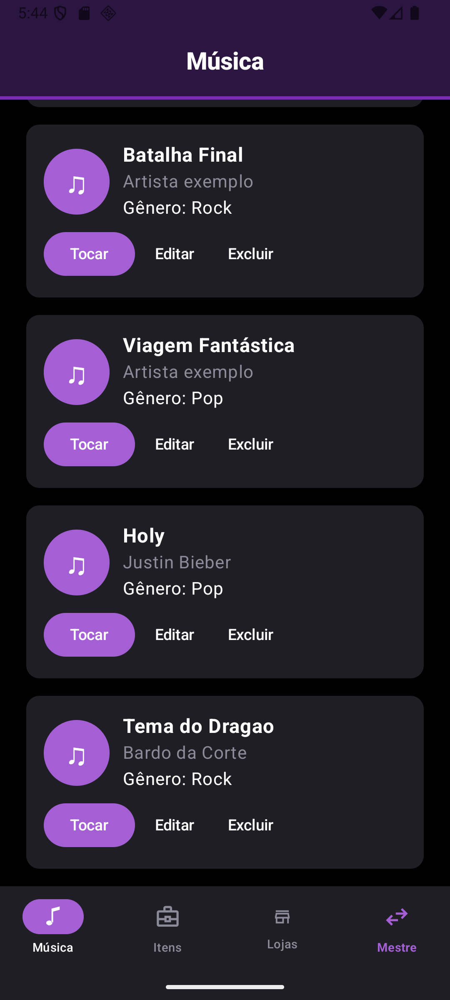 | 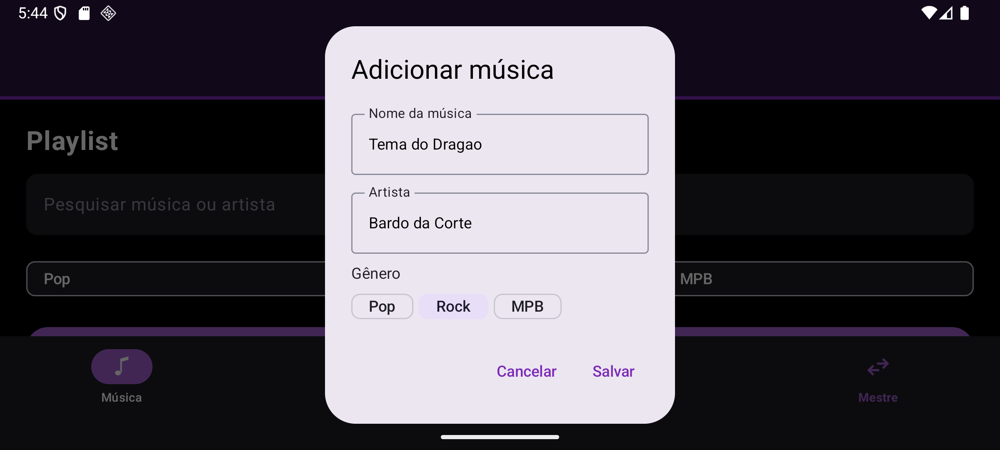 |

### 2. Quais Entity, DAO e Database foram criados, e por que esses campos?

Reaproveitamos as data classes do Trabalho 2. Cada uma virou uma `@Entity(tableName = "...")` com `@PrimaryKey(autoGenerate = true) val id: Int = 0`. Criamos **4 entidades**, duas a mais que o mínimo, para que a ficha e a playlist também fossem salvas.

| Entity | Tabela | Campos | Por quê |
|---|---|---|---|
| `ItemRpg` | `itens` | `id`, `itemName`, `itemValue`, `itemDescription`, `itemCat` | São os campos que o formulário de item já tinha. A categoria é salva **só pelo nome** ("Armas"). O ícone é um id de recurso (`R.drawable...`) que pode mudar a cada build, então o ícone é recuperado da lista `listCatItem` ao ler. |
| `LojaRpg` | `lojas` | `id`, `nome`, `descricao`, `imagemUri`, `visivel`, `itemIds` | `visivel` decide se o jogador vê a loja. `itemIds` guarda os itens à venda (ex.: `"1,2"`), que é a ligação entre lojas e itens feita no Trabalho 2. |
| `CharacterSheet` | `fichas` | `id`, `name`, `level`, `characterClass`, `race`, `attributes`, `status`, `skills` | Tudo o que a ficha editável mostra. O app usa uma ficha só, que é inserida na primeira vez e atualizada depois. |
| `Musica` | `musicas` | `id`, `titulo`, `artista`, `genero` | Os campos do cadastro de música. `genero` alimenta os filtros Pop/Rock/MPB. |

**Conversores (`@TypeConverter`):** o SQLite só guarda tipos simples, como número e texto. A classe `Converters` transforma em texto:
- a categoria (pelo nome);
- o `Uri` da imagem;
- o conjunto de ids de itens (`"1,2"`);
- as listas de atributos, status e perícias da ficha (em JSON).

Escolhemos o conversor em vez de uma tabela de ligação loja–item para manter o mesmo modelo do Trabalho 2.

**`AppDatabase`:** é uma `abstract class AppDatabase : RoomDatabase()` com `@Database(entities = [ItemRpg::class, LojaRpg::class, CharacterSheet::class, Musica::class], version = 1)`. Ela expõe os 4 DAOs e segue o padrão Singleton visto em aula:

```kotlin
companion object {
    @Volatile
    private var INSTANCE: AppDatabase? = null

    fun getDatabase(context: Context): AppDatabase {
        return INSTANCE ?: synchronized(this) {
            val instance = Room.databaseBuilder(
                context.applicationContext,
                AppDatabase::class.java,
                "app_rpg.db"
            ).addCallback(musicasIniciais).build()
            INSTANCE = instance
            instance
        }
    }
}
```

As 4 músicas de exemplo da playlist são inseridas por um `Callback` que só roda quando o arquivo do banco é criado. Assim, uma música de exemplo excluída não volta.

O conteúdo real do banco no emulador, lido com `sqlite3`, depois dos prints da seção 5:

```text
== itens
id  itemName            itemValue  itemDescription        itemCat
1   Espada Longa        150        Forjada nas montanhas  Armas
2   Cota de Malha       450        Leve e resistente      Armaduras
3   Biscoito de Viagem  5          Alimenta por um dia    Alimentos
== lojas
id  nome               descricao                                 imagemUri  visivel  itemIds
1   Forja do Norte     Armas e armaduras forjadas nas montanhas             1        1,2
2   Taverna do Javali  Comida quente e bebida gelada                        1        3
== musicas
id  titulo             artista          genero
1   Trilha da Taverna  Artista exemplo  MPB
...
5   Tema do Dragao     Bardo da Corte   Rock
== fichas
id  name    level  characterClass  race    attributes
1   Thorin  5      Guerreiro       Humano  [{"valor":"1","label":"For"}, ...]
```

### 3. Como estruturamos as queries do DAO

Cada entidade tem o seu DAO (`ItemDao`, `LojaDao`, `FichaDao`, `MusicaDao`), todos com os 4 métodos básicos como `suspend fun`:

```kotlin
@Insert suspend fun inserir(item: ItemRpg): Long
@Query("SELECT * FROM itens ORDER BY id") suspend fun buscarTodos(): List<ItemRpg>
@Update suspend fun atualizar(item: ItemRpg)
@Delete suspend fun deletar(item: ItemRpg)
```

- **`ORDER BY id`** mantém as listas na ordem em que os registros foram criados, como era no Trabalho 2.
- **Consultas extras:**
  - `ItemDao.buscarPorId(id)` e `LojaDao.buscarPorId(id)`, com `WHERE id = :id`. São elas que permitem às telas de detalhe buscar o registro certo no banco (seção 3.3 do enunciado).
  - `ItemDao.buscarPorIds(ids)`, com `WHERE id IN (:ids)`. Busca só os itens de uma loja, em uma consulta.
- **Telas de detalhe lendo do banco:**
  - A **tela da loja** recebe só o `storeId` pela rota. Ela chama `lojaDao.buscarPorId(id)` e depois `itemDao.buscarPorIds(loja.itemIds)`.
  - A **edição de item** recebe só o `itemId` e chama `itemDao.buscarPorId(id)` antes de preencher o formulário.
  - Testamos as duas logo depois de reabrir o app, sem abrir nenhuma lista antes: as listas em memória estavam vazias, então os dados só podiam vir do banco.
- **Toda chamada ao DAO passa por uma única função** do ViewModel. Ela roda em `CoroutineScope(Dispatchers.IO).launch` e trata erros com `try/catch` + `Log.e`:

  ```kotlin
  private fun executarNoBanco(mensagemErro: String, operacao: suspend () -> Unit): Job =
      CoroutineScope(Dispatchers.IO).launch {
          try {
              operacao()
          } catch (e: Exception) {
              Log.e(TAG, mensagemErro, e)
          }
      }
  ```

  Por exemplo, salvar um item: `executarNoBanco("Erro ao salvar item") { if (item.id == 0) itemDao.inserir(item) else itemDao.atualizar(item); recarregarItens() }`. O resultado volta para a tela com `withContext(Dispatchers.Main)`.
- **Carregar ao abrir:** cada tela de lista busca seus dados assim que abre, com `LaunchedEffect(Unit) { viewModel.carregarItens() }` (e o equivalente para lojas, músicas e ficha).

### 4. Dificuldades em migrar de `mutableStateListOf` para Room, e o que quebrou

- **Ids:** antes, o id de um registro novo era calculado na mão (`maior id + 1`). Agora quem gera é o Room (`autoGenerate`). A regra virou: `id == 0` chama `inserir`, senão chama `atualizar`. Isso também resolveu ids reaproveitados: um item novo podia ganhar o id de um item excluído e aparecer sozinho em lojas antigas.
- **Telas vazias:** depois de trocar as listas, elas começavam vazias até alguém buscar do banco. Resolvemos com `LaunchedEffect(Unit)` em cada tela.
- **A rotação apagava o rascunho:** o `LaunchedEffect` roda de novo quando o celular gira, e recarregar do banco apagava o que estava sendo digitado na ficha e no formulário de item. Agora a ficha só é carregada uma vez, e o formulário só é preenchido uma vez por abertura (`formKey`).
- **O ViewModel precisava de um `Context` para abrir o banco:** passou a ser `AndroidViewModel(application)`. Com isso os `@Preview` que criavam `MeuViewModel()` deixaram de compilar. Eles agora recebem listas de exemplo direto.
- **Item excluído continuava nas lojas:** a exclusão de item e a remoção dele de todas as lojas rodam juntas em uma transação (`banco.withTransaction { ... }`).
- **A categoria do item não podia ir para o banco do jeito que estava,** porque guardava o id de um ícone. Resolvemos com um conversor que salva só o nome.
- **Duas coisas que quebraram na migração para ViewModel**, que só apareceram quando testamos o Room:
  - **A ficha não podia mais ser editada:** a tela alterava uma variável local (`var draft = viewModel.characterDraft`) e o ViewModel nunca recebia a mudança. Agora a tela chama `viewModel.atualizarRascunhoFicha(...)`.
  - **O formulário de item não era reiniciado:** "Criar item" abria com o texto do item anterior. O primeiro teste salvou um item chamado "EscudoEspada", com valor "80150". O "Editar item" também não vinha preenchido. O formulário de loja já chamava `iniciarFormularioLoja`; faltava a chamada equivalente no de item.
- **Configuração do KSP:** o projeto usa o Android Gradle Plugin 9, que compila o Kotlin sozinho. A versão 2.3 do KSP funcionou sem ajustes. Seguimos a ordem vista em aula: o plugin `com.google.devtools.ksp`, sincronizar, e só depois o `ksp("androidx.room:room-compiler")`.

### 5. Teste de persistência: adicionar, fechar o app e reabrir

**Adicionar um item, fechar o app completamente e abrir de novo.** O app foi fechado pela tela de apps recentes, e o processo foi encerrado de verdade (`pidof` não encontrou o app).

| 1. Itens adicionados | 2. Fechando pelos recentes | 3. App fechado | 4. Reaberto: itens continuam lá |
|:---:|:---:|:---:|:---:|
|  | 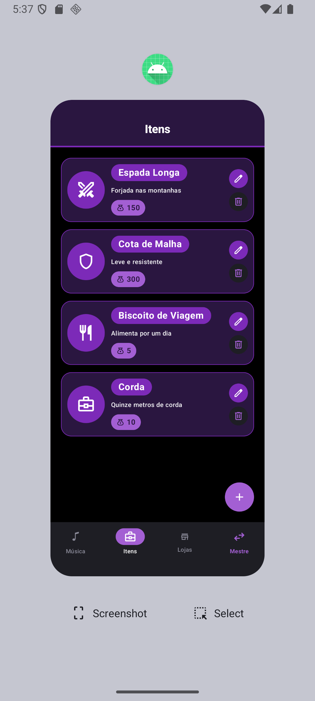 | 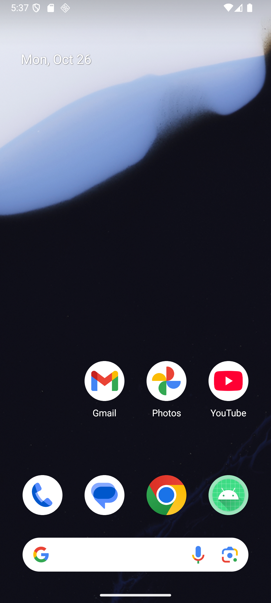 | 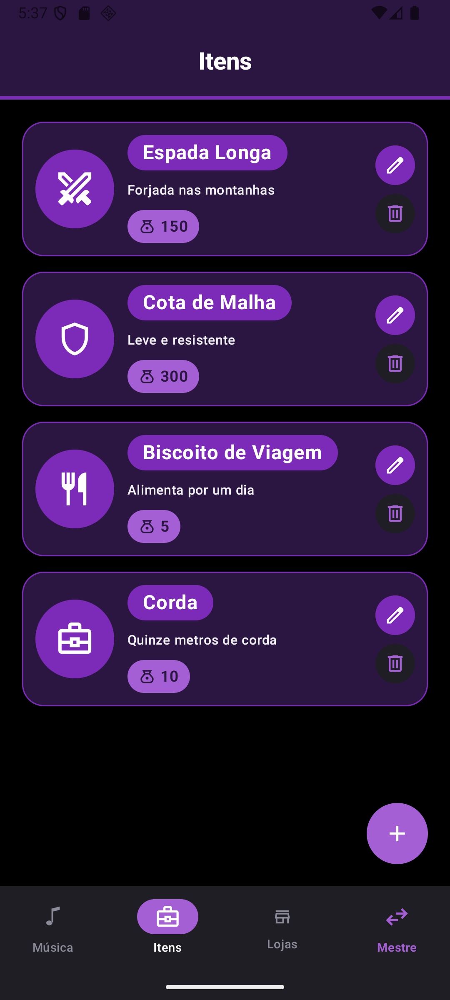 |

**Editar e excluir, também com o app fechado e reaberto depois de cada um:**

| Editar: preenchido do banco | Valor 300 → 450 | Reaberto: 450 | Excluir "Corda" | Reaberto: "Corda" sumiu |
|:---:|:---:|:---:|:---:|:---:|
| 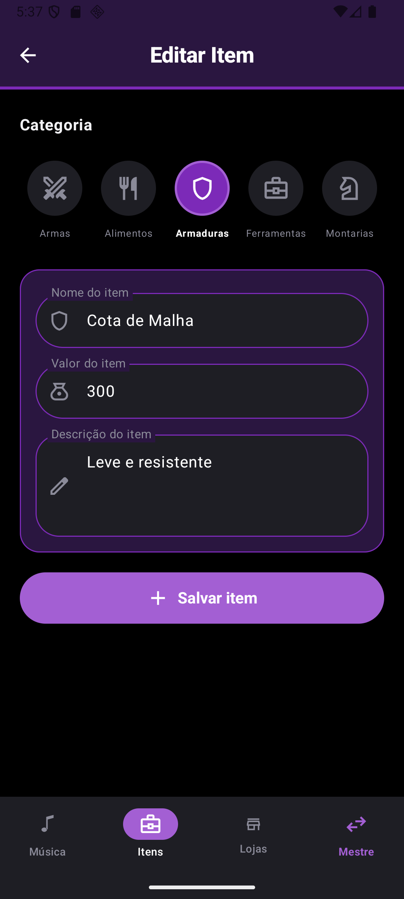 |  |  | 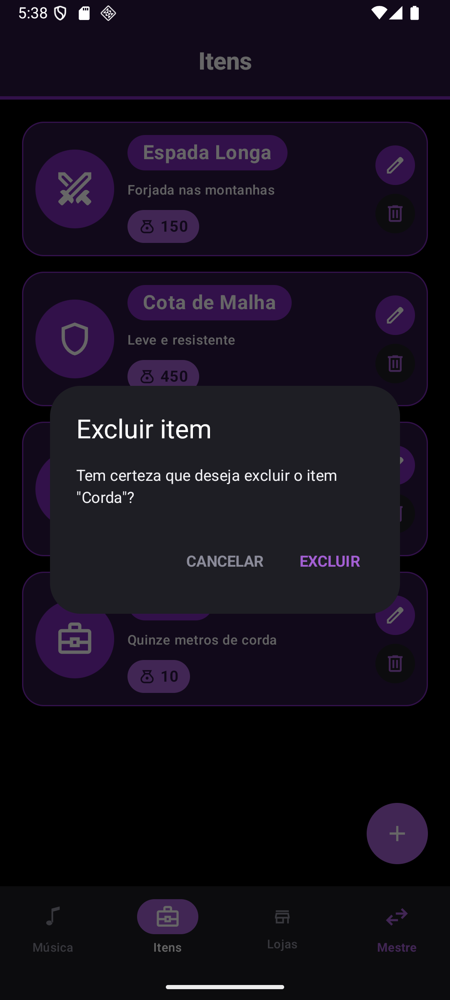 | 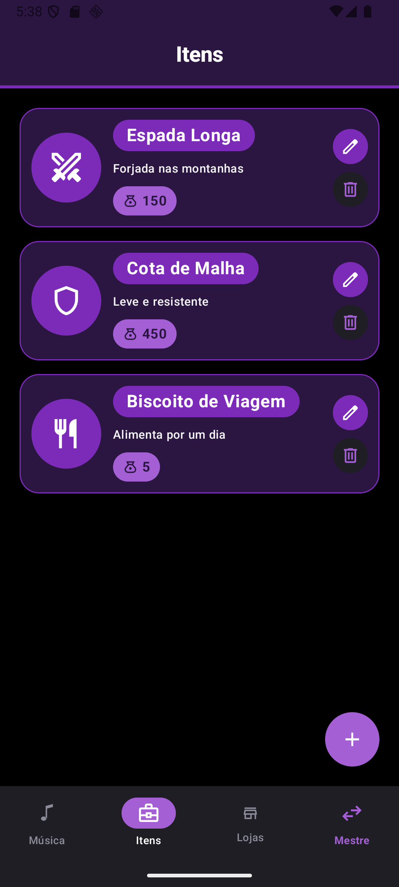 |

**Lojas, ficha e playlist depois de reabrir o app:**

| Loja criada com itens | Lojas (Mestre) | Detalhe da loja (Jogador), lido por id | Ficha salva |
|:---:|:---:|:---:|:---:|
| 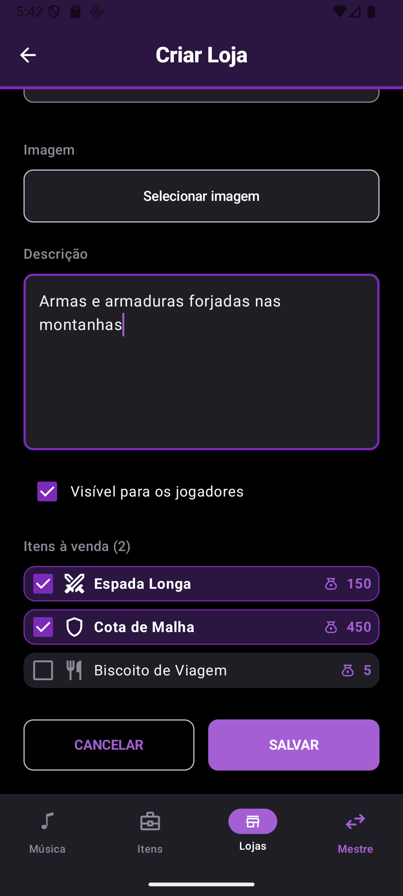 | 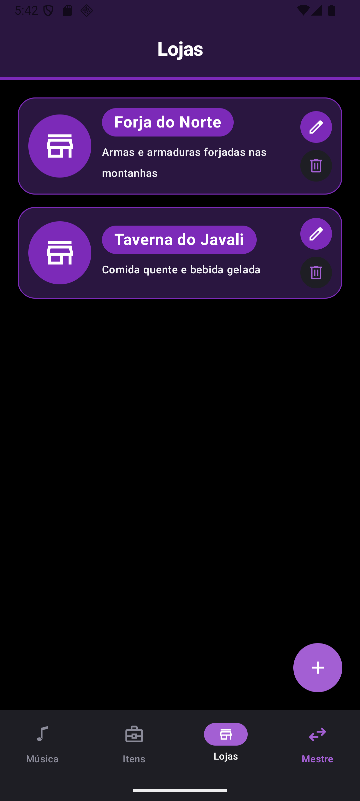 | 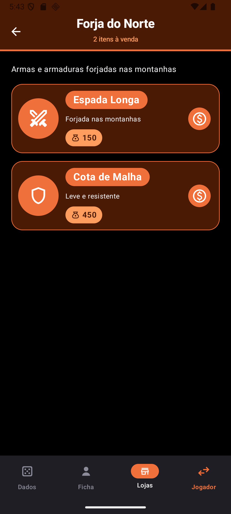 | 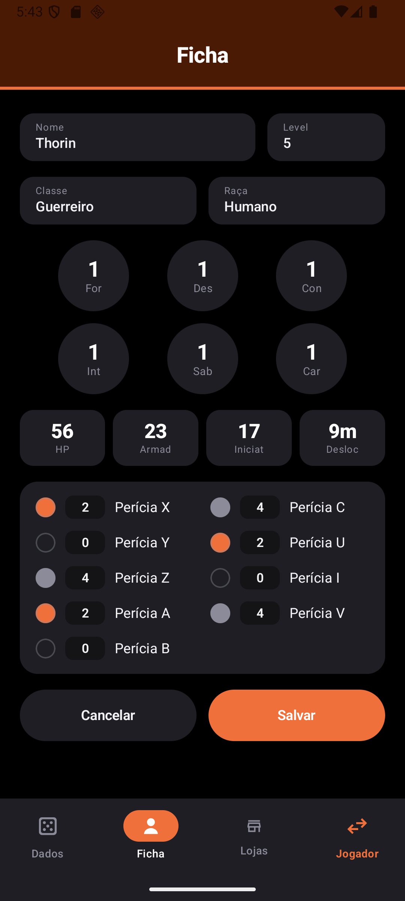 |

### 6. Algum integrante teve dificuldade? Como resolveram?

- **Gabriela:** a rotação do celular apagava os dados, porque o estado vivia em `remember` dentro das telas. Ela resolveu movendo esse estado para o `MeuViewModel`, que continua vivo quando a Activity é recriada. Isso incluiu os campos dos formulários de item e de loja, para que o texto digitado também não se perdesse.
- **Michelle:** depois da migração para o ViewModel, a rolagem da playlist e da lista de lojas do jogador deu problema. Ela reorganizou a playlist para que título, pesquisa, filtros e músicas ficassem em um único `LazyColumn`, com a barra de reprodução fixa fora dele. Também passou a guardar a posição da rolagem com `rememberLazyListState`.
- **Bruno:**
  - os diálogos da playlist fechavam ao girar o celular, e o texto se perdia. Resolveu trocando `remember` por `rememberSaveable` e guardando só o id da música em edição.
  - depois, na migração para o Room, encontrou e corrigiu os dois problemas da seção 4: a ficha que não salvava edições e o formulário de item que não reiniciava.

## Autores

Desenvolvido por **Bruno, Gabriela e Michelle** como projeto acadêmico e de aprendizado durante o curso de **Ciência da Computação**.

---
